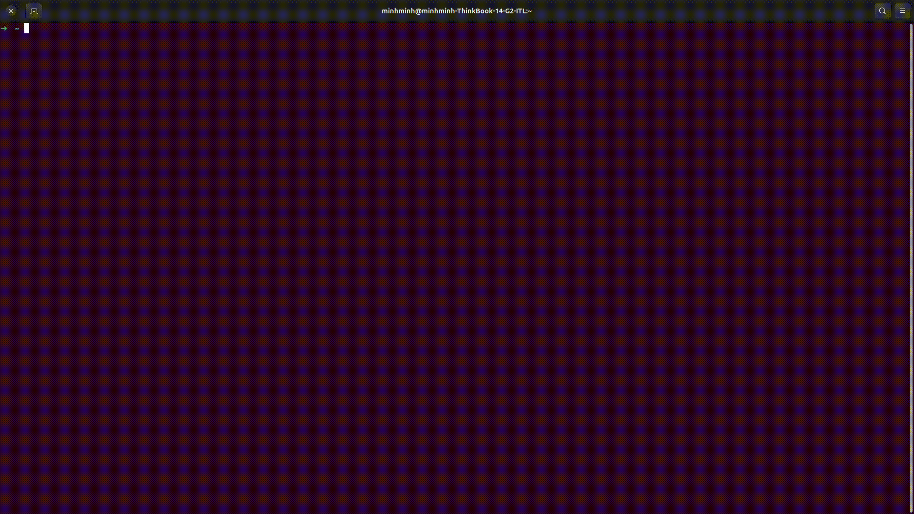

# Dotfiles

Personal setup for Linux / WSL. Follows **DRY — Don't Repeat Yourself**: one source of truth for every config, linked into `$HOME`.

## What's inside

| Path | Tool | Notes |
| --- | --- | --- |
| `.zshrc` | Zsh + Oh My Zsh | Theme `robbyrussell`; plugins `git`, `tmux`, `zsh-syntax-highlighting`, `zsh-autosuggestions`; PATH for nvm, pnpm, Java 21, lazygit |
| `.tmux.conf` | tmux | Prefix `Ctrl+s`, mouse on, status bar on top, `\` / `-` to split |
| `.config/tmux/plugins/tpm` | tmux plugin manager | Bundled TPM |
| `.config/nvim` | Neovim (LazyVim) | Custom plugins in `lua/plugins/`, e.g. lazydocker |
| `.config/lazygit/config.yml` | lazygit | |
| `.config/lazydocker/config.yml` | lazydocker | |
| `vimium/.vim.conf` | Vimium (browser extension) | Key mappings |
| `scripts/install-ohmyzsh.sh` | Oh My Zsh | Official installer |
| `scripts/install-dotnet.sh` | .NET SDK 10.0 | Installs dependencies + SDK via apt |
| `scripts/setup-window-server.md` | WSL 2 | Guide: Ubuntu on WSL 2, systemd, SSH, mirrored networking, keep-alive |
| `shell_note.md` | — | Personal command notes (Docker, etc.) |

## Demo video 


## Setup

### 1. Clone

```sh
git clone <repo-url> ~/workspace/dotfile
cd ~/workspace/dotfile
```

### 2. Install the tools

Requirements: `git`, `zsh`, `stow`.

```sh
sudo apt-get install -y git zsh stow

# Oh My Zsh
sh scripts/install-ohmyzsh.sh --keep-zshrc

# Zsh plugins used in .zshrc
git clone https://github.com/zsh-users/zsh-syntax-highlighting ${ZSH_CUSTOM:-~/.oh-my-zsh/custom}/plugins/zsh-syntax-highlighting
git clone https://github.com/zsh-users/zsh-autosuggestions ${ZSH_CUSTOM:-~/.oh-my-zsh/custom}/plugins/zsh-autosuggestions

# Optional: .NET SDK
bash scripts/install-dotnet.sh
```

Also install as needed: `tmux`, `neovim`, `lazygit`, `lazydocker`, `nvm`, `pnpm`.

### 3. Link configs into `$HOME`

Configs are symlinked with [GNU Stow](https://www.gnu.org/software/stow/), so edits stay in this repo. Run from the repo root:

```sh
stow -n -v -t ~ .   # dry run: preview the links
stow -v -t ~ .      # create the links
```

- `-t ~` is required because the repo lives in `~/workspace/dotfile`, not directly under `$HOME`.
- Re-link after adding new files: `stow -R -v -t ~ .`
- Remove all links: `stow -D -v -t ~ .`
- Files that should not be linked (README, `scripts/`, `.ssh/`, notes, logs) are listed in `.stow-local-ignore`.
- If a real file already exists in `$HOME` (e.g. a default `~/.zshrc`), stow stops with a conflict. Back it up and remove it, then run stow again.

### 4. Reload

```sh
source ~/.zshrc
tmux source-file ~/.tmux.conf   # or <prefix> r inside tmux
nvim                            # LazyVim installs plugins on first launch
```

Inside tmux, press `<prefix> I` (`Ctrl+s` then `Shift+i`) to install TPM plugins.

## Key bindings

### tmux

| Key | Action |
| --- | --- |
| `Ctrl+s` | Prefix |
| `<prefix> \` | Split horizontally |
| `<prefix> -` | Split vertically |
| `<prefix> r` | Reload config |

### Neovim

| Key | Action |
| --- | --- |
| `<leader>ld` | Open lazydocker in a floating window |

## WSL

See [scripts/setup-window-server.md](scripts/setup-window-server.md) to set up Ubuntu on WSL 2 with SSH and mirrored networking.

## Notes

- `.ssh/` is git-ignored — keys are never committed.
- `.zshrc` contains machine-specific aliases; review before using on a new machine.
